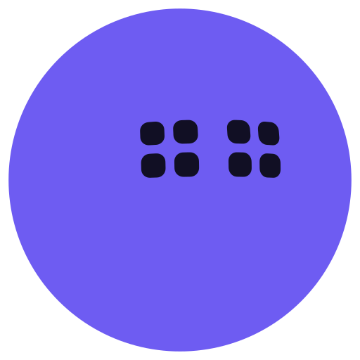
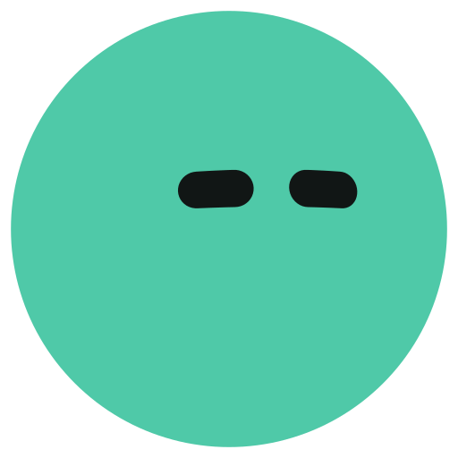
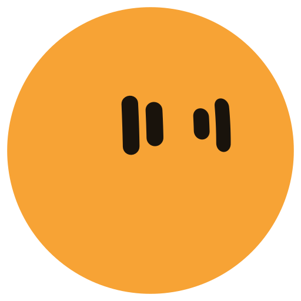
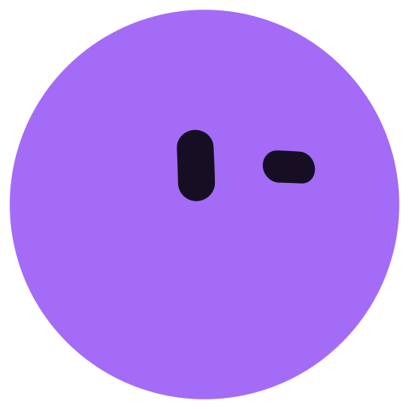

# orb 2

Geometric avatars with custom SVG silhouettes and heavy, shape-shifting eyes.

`<orb-avatar>` v2 is a single, dependency-free Web Component. Each avatar maps bold, high-contrast pill and multi-cell eyes onto a 3D curved surface inside **any silhouette** — from circles, squircles, and teardrops to custom SVG paths. Eyes dart crisply across the surface, split seamlessly from pills into 2×2 or 3×3 grids and fuse into sideways capsules, and keep constant optical ink weight across every frame.

**[Live studio and playground →](https://aphesist.github.io/orb2/)**

<p>
  
  
  
  
  
  
</p>

## What's new in v2

- **15 built-in body silhouettes + custom SVG shapes.** Use `circle`, `squircle`, `triangle`, `cloud`, `soft`, `tall`, `wide`, `bean`, `drop`, `ghost`, `clover`, `flower`, `diamond`, `hexagon`, or `star` — or pass any SVG `d` path string, `#selector`, or `<svg slot="shape">`. Silhouettes turn volumetrically in 3D (pitching their crown back and rounding their belly as they gaze around) and morph smoothly when `shape` changes. Every built-in silhouette is a complete 3D solid that reads as itself from every side: a rounded cone, teardrop, dome, marshmallow and pills of revolution, a rounded box, a hex prism, a gem, and puff clusters for the cloud, clover, flower and star. Custom SVG outlines are inflated into 3D automatically.
- **Autonomous ambient idle life.** Even when nothing external is happening, idle orbs behave like curious desk companions — holding calm poses, cocking their heads, peeking all the way to the 3D rim, gazing up at the ceiling, double-blinking, and subtly shifting eye shapes.
- **Heavy, solid pill-first eye geometry.** Every eye state (`pill`, `circle`, `wide`, `grid`, `matrix`, `bars`, `stack`, `square`, `plus`, `diamond`, `arc`, `chevron`, `slant`, `rest`, `heart`) is matched in solid optical ink area. No thin hairlines, no hollow outlines — even blinks morph into a bold horizontal capsule.
- **Multi-cell topological morphing.** A single solid eye subdivides cleanly into a 4-cell (`2×2`) or 9-cell (`3×3`) matrix and coalesces back into a sideways pill or circle with staggered quintic timing and subtle left-to-right lead-follow.
- **Pure eye-movement choreographies & `sequence()`.** Autonomous `alive` emotes and scripted sequences (`orb.sequence([...])`) focus on crisp geometric eye motion and shape transitions rather than noisy cartoon text popups.
- **Dual-rate gaze physics.** Eye saccades snap rapidly onto target while body tilt follows on a softer, cushioned secondary spring.

## Quick start

```html
<script src="https://cdn.jsdelivr.net/gh/aphesist/orb2@main/orb-avatar.min.js"></script>

<orb-avatar shape="squircle" eye-shape="pill" color="#4fc9a8" mode="follow"></orb-avatar>
```

## Install

| Method | How |
|---|---|
| CDN | `<script src="https://cdn.jsdelivr.net/gh/aphesist/orb2@main/orb-avatar.min.js"></script>` |
| Copy the file | Drop [`orb-avatar.min.js`](orb-avatar.min.js) (or readable [`orb-avatar.js`](orb-avatar.js)) into your project. |
| npm (from GitHub) | `npm install github:aphesist/orb2`, then `import 'orb-avatar-v2';`. Types are included in [`orb-avatar.d.ts`](orb-avatar.d.ts). |

## Body silhouettes & custom SVG shapes

Set the body silhouette with `shape`:

| Built-in `shape` | Silhouette |
|---|---|
| `circle` (default) | Classic round sphere |
| `squircle` | Hardware-grade superellipse ($n = 3.7$) |
| `triangle` | Plush rounded pyramid |
| `cloud` | Multi-lobe organic cloud |
| `soft` | Grounded mallow pillow |
| `tall` | Standing vertical capsule |
| `wide` | Compact horizontal capsule |
| `bean` | Softly tilted standing pebble |
| `drop` | Tapered teardrop with weighted belly |
| `ghost` | Rounded arch dome with cushioned base |
| `clover` | Four-lobed soft clover |
| `flower` | Six-lobed plush daisy |
| `diamond` | Rounded rotated lozenge |
| `hexagon` | Rounded tactile hexagon |
| `star` | Five-lobed soft spark |

### Custom SVG compatibility

You can supply custom vector shapes in three ways:

```html
<!-- 1. Inline SVG path string -->
<orb-avatar shape="M 0 -95 L 84 -60 L 84 8 C 84 58 46 88 0 98 C -46 88 -84 58 -84 8 L -84 -60 Z"></orb-avatar>

<!-- 2. Slotted <svg> element (supports <path>, <polygon>, <rect>, <circle>, <ellipse>) -->
<orb-avatar reaction="compute" color="#f7a335">
  <svg slot="shape" viewBox="0 0 100 100">
    <path d="M50 4 L94 28 L94 72 L50 96 L6 72 L6 28 Z" />
  </svg>
</orb-avatar>
```

```js
// 3. Register a named silhouette once and reuse everywhere
OrbAvatar.defineShape('shield', 'M 0 -95 L 84 -60 L 84 8 C 84 58 46 88 0 98 C -46 88 -84 58 -84 8 L -84 -60 Z');
```

Every custom SVG is normalized, resampled to uniform arc length for smooth silhouette morphing, analyzed via centroid + pole-of-inaccessibility to place the face naturally, and used as a live clip horizon as the eyes turn in 3D.

Custom outlines become real 3D bodies: each is inflated into a union of spheres along its medial axis, so head-on it matches your path exactly and, turned, every part keeps a round volume as thick as it is wide. Pass `{ flat: true }` to `defineShape` to keep the classic extruded coin instead.

## Heavy eye shapes & multi-cell morphing

In `idle` reaction, `eye-shape` sets the resting eye geometry — either symmetric (`eye-shape="grid"`) or asymmetric (`eye-shape="circle wide"`):

| `eye-shape` | Geometry |
|---|---|
| `pill` (default) | Bold vertical stadium capsule |
| `tall` | Extra-tall vertical capsule |
| `circle` | Solid circle matched in ink area to `pill` |
| `wide` | Sideways horizontal capsule |
| `squint` | Compact half-height horizontal capsule |
| `square` | Heavy rounded block |
| `grid` | 2×2 matrix of 4 bold rounded cells per eye |
| `matrix` | 3×3 dot-matrix of 9 cells per eye |
| `bars` | Dual vertical equalizer capsules (`\|\|`) |
| `stack` | Dual horizontal capsules (`=`) |
| `plus` | Heavy filleted `+` cross |
| `diamond` | Rotated rounded square |
| `arc` | Bold round-capped `^` curve |
| `rest` | Bold resting curve |
| `chevron` | Bold inward `> <` chevrons |
| `slant` | Angled heavy capsules |
| `heart` | Plush solid heart |

Call `orb.morphEyes('grid')` at any time to smoothly transition from the live face into a new eye shape.

## Eye choreographies & `sequence()`

Add `alive` to let an idle orb periodically run pure eye-movement and shape-shifting choreographies, or trigger any choreography on demand with `orb.emote(name)`:

| Choreography (`emote`) | Sequence |
|---|---|
| `shapeshift` | `pill` → `circle` → `2×2 grid` → `wide` (sideways pill) → `pill` |
| `pixelate` | `pill` → `square` → rippling `2×2 grid` → `circle` → `pill` |
| `scan` | Narrows to `wide` sideways pills and scans across lines with crisp saccades |
| `calibrate` | Staggered left/right `pill` → `wide` → `plus` → `diamond` → `circle` → `pill` |
| `doubletake` | Quick glance, snaps back wide-eyed `circle`, narrows to `wide`, relaxes |
| `matrix` | Splits into `3×3 matrix`, sweeps a wave across both eyes, fuses via `stack` |
| `equalize` | Splits into dual `bars` pulsing out of phase, then merges back |
| `curious` | Asymmetric `(circle, wide)` ↔ `(wide, circle)` swap with micro-glances |
| `orbit` | Morphs to `circle` and traces a smooth 360° rim glance |
| `glare` | Compresses to `wide` sideways pills and slides left and right |
| `winkswap` | Crisp alternating heavy `arc` winks |
| `slowblink` | Weighty slow blink into horizontal capsules |

### Scripted sequences in one call

```js
orb.sequence([
  { eyes: 'pill',   gaze: [0, 6],    hold: 0.5 },
  { eyes: 'circle', gaze: [22, 12],  hold: 0.7 },
  { eyes: 'grid',   gaze: [-18, 4],  hold: 0.9 },
  { eyes: 'wide',   gaze: [16, -4],  hold: 0.8 },
  { eyes: 'pill',   gaze: [0, 6],    hold: 0.5 },
]);
```

## Reactions

| Reaction | Face & Motion |
|---|---|
| `idle` | Displays `eye-shape` (`pill` by default) with heavy capsule blinks |
| `listening` | Chunky `circle` eyes, attentive forward gaze |
| `thinking` | Asymmetric tall pill + sideways pill, upward-sideways glances |
| `compute` | Traveling wave across `2×2 grid` eyes |
| `working` | Focused slanted capsules scanning left-to-right with carriage-return saccades |
| `speaking` | Modulating dual `bars` voice waveform |
| `happy` | Heavy `^ ^` arcs with gentle bounce |
| `done` | Heavy `^ ^` arcs with a crisp hop |
| `needs` | Tall expressive pills with attention hop |
| `sleeping` | Heavy resting curves, lowered gaze, calm breathing |
| `error` | Bold `> <` chevrons with crisp horizontal shake |
| `wink` | Left `pill` + right `arc` with subtle head tilt |
| `skeptic` | Deadpan `pill` + sideways `wide` pill |
| `love` | Bold solid hearts with gentle sway |
| `sad` | Outward-slanted droopy capsules, lowered gaze |
| `dizzy` | Counter-rotating heavy `+` crosses |

## Attributes & JavaScript API

| Attribute | Default | Description |
|---|---|---|
| `shape` | `circle` | Built-in silhouette name, registered shape, `#id` selector, or SVG `d` path. |
| `eye-shape` | `pill` | Eye shape in `idle` (`"grid"`, `"wide"`, or `"circle wide"`). |
| `reaction` | `idle` | Active reaction name. |
| `mode` | `drift` | `drift`, `follow`, `wander`, or `fixed`. |
| `gaze` | `10 7` | Home or fixed `"yaw pitch"` in degrees. |
| `color` | `#f1efe9` | Body fill color (any CSS color or custom property). |
| `eye-color` | `#141418` | Eye fill color. |
| `size` | `64` | Width/height in px or CSS length. |
| `morph` | `0.38` | Seconds for eye and silhouette transitions. |
| `jelly` | `0.55` | Soft-body harmonic bounce (`0` to `1`). |
| `face-scale` | `1` | Face scale multiplier. |
| `alive` | off | Plays full multi-step eye choreographies (`shapeshift`, `pixelate`, `scan`, etc.) periodically while idle; sleeps after `sleep-after` seconds. |
| `idle-motion` | `lively` | Ambient idle behavior: `lively` (rim peeks, head tilts, sky gazes & micro-morphs), `calm` (gentle glances), or `off`. |
| `extras` | off | Opt-in floating accents (`extras` or `extras="on"`). |
| `shadow` | off | Grounded floor shadow adapted to the active silhouette. |
| `static` | off | Renders a single still frame with zero animation loop overhead. |

```js
const orb = document.querySelector('orb-avatar');

orb.setShape('drop');            // morphs silhouette
orb.morphEyes('grid');           // morphs eyes to 2x2 grid
orb.react('compute');            // morphs to reaction
orb.emote('shapeshift');         // plays eye choreography
orb.poke();                      // soft-body jiggle + poke reaction
orb.blink();                     // heavy horizontal-pill blink
orb.spin();                      // 360° surface spin
orb.lookAt(x, y);                // look at viewport coordinates (lookAt() to release)
const svg = orb.toSVG({ size: 512 });
```

## Development

Edit [`orb-avatar.js`](orb-avatar.js) and open [`index.html`](index.html) in a browser. Regenerate the minified bundle with:

```bash
npx terser orb-avatar.js -c passes=2 -m --comments '/^!/' -o orb-avatar.min.js
```

## License

[MIT](LICENSE) © 2026 Enzo Vasconcelos.
